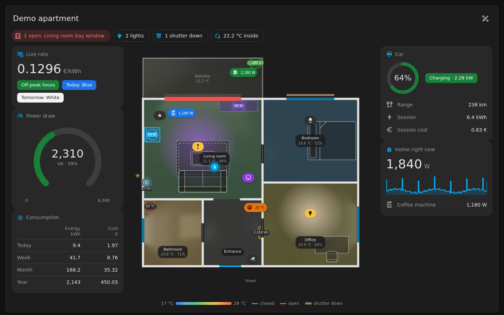
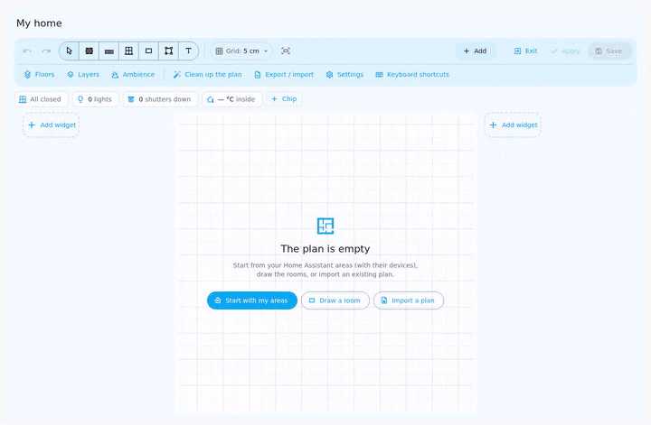
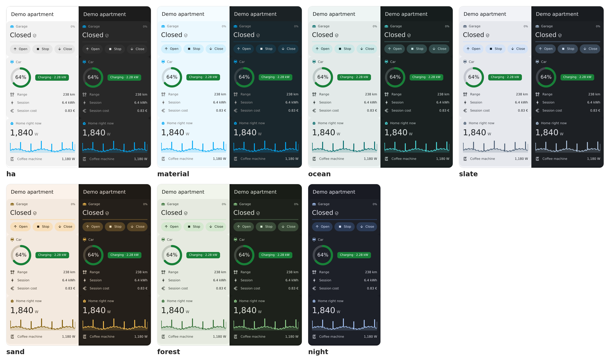

# Maquette

🇬🇧 [English version](README.md)

[](https://hacs.xyz/docs/faq/custom_repositories/)
[](https://github.com/TooMuhtsh/maquette-card/releases)
[](LICENSE)

**Un plan de maison vivant pour Home Assistant.**
Votre logement vu de dessus, en direct, dessiné directement dans votre tableau de bord : pas d'image de plan, pas d'outil externe, pas de YAML.



<p align="center">
  <a href="https://toomuhtsh.github.io/maquette-card/"><b>Essayer en ligne</b></a> (l'appartement de démo, sans rien installer)
  &nbsp;·&nbsp;
  <a href="#installation"><b>Installer</b></a>
  &nbsp;·&nbsp;
  <a href="https://github.com/TooMuhtsh/maquette-card/wiki/Home-FR"><b>Wiki</b></a>
</p>

## Ce qu'elle fait

- Les lumières éclairent leur pièce, portes et fenêtres ouvertes passent en rouge, les volets sont à leur vraie position.
- Les pièces sont teintées selon la température ; les meubles connectés (borne de recharge, frigo, TV…) affichent leur puissance.
- Un plan par étage, avec des escaliers vers l'étage voisin et des alertes qui couvrent toute la maison.
- Un éditeur intégré (administrateurs seulement) : murs, pièces, ouvertures, 45 meubles, vos pièces Home Assistant en un clic.
- Dans l'éditeur aussi : bibliothèque de widgets et partage, nettoyage du plan, calques et annuler. Et un mode tablette murale.
- 65 widgets prêts à l'emploi (CO₂, fuite, serrure, voiture, tarif, pH de piscine…) pour les panneaux latéraux et la fiche que chaque élément ouvre au toucher.
- Une ambiance facultative : jour et nuit d'après le soleil, vraie météo, flux d'énergie, lumière du soleil et de la lune par les fenêtres.
- Revoir les 1 à 72 dernières heures de tout le plan.
- Les actions sensibles (déverrouiller, ouvrir un garage, désarmer…) sont toujours confirmées dans un dialogue qui nomme le vrai service.
- Sept thèmes, clair et sombre, téléphone et PC, français et anglais.

La liste complète est sur le [wiki](https://github.com/TooMuhtsh/maquette-card/wiki/Home-FR).

## Dessinez votre maison

Cliquez sur le bouton d'édition en haut à droite de la carte. Sur un plan vide, *Démarrer avec mes pièces* crée une
pièce par pièce de Home Assistant, avec ses appareils prêts à placer ; dessinez ensuite les pièces (**R**), posez portes
et fenêtres sur les murs, meublez et enregistrez. Le plan est stocké dans le tableau de bord comme n'importe quelle carte.



Pas à pas : [Guide de l'éditeur](https://github.com/TooMuhtsh/maquette-card/wiki/Editor-guide-FR).

## Nouveautés de la 0.4.0

- Sept thèmes intégrés ; `ha`, le nouveau défaut, se fond comme une carte Lovelace classique (`material` garde l'ancien rendu).
- Des variables CSS publiques `--maquette-*` et un CSS personnalisé contrôlé, dans ⚙ Paramètres › Apparence.
- Plus légère au repos, surtout sur téléphone, et un avis quand une version plus récente sort (avec HACS).



Le détail : [Nouveautés de la 0.4.0](https://github.com/TooMuhtsh/maquette-card/wiki/Home-FR#nouveautés-de-la-040) · [Historique des versions](https://github.com/TooMuhtsh/maquette-card/wiki/Changelog-FR).

Plus de captures sur le [wiki](https://github.com/TooMuhtsh/maquette-card/wiki/Screenshots-FR), ou tout essayer dans la [démo en ligne](https://toomuhtsh.github.io/maquette-card/).

## Prérequis

- Home Assistant **2023.9** ou plus récent.
- Un navigateur récent ou l'application compagnon : **Chrome / Edge 111+, Safari 16.4+, Firefox 121+**.
- Un compte **administrateur** Home Assistant pour modifier le plan. Les autres utilisateurs le voient et s'en servent.

## Installation

[](https://my.home-assistant.io/redirect/hacs_repository/?owner=TooMuhtsh&repository=maquette-card&category=plugin)

1. HACS → ⋮ → **Dépôts personnalisés** → ajoutez `https://github.com/TooMuhtsh/maquette-card`, type **Dashboard**.
2. Téléchargez **Maquette**, puis rechargez le navigateur.

<details>
<summary>Installation manuelle</summary>

1. Téléchargez `maquette-card.js` **et** `maquette-editeur.js` depuis la
   [dernière version](https://github.com/TooMuhtsh/maquette-card/releases/latest).
2. Copiez les deux dans `/config/www/` (même dossier).
3. Paramètres → Tableaux de bord → ⋮ → **Ressources** → ajoutez `/local/maquette-card.js` en tant que **module
   JavaScript** (celui-ci seulement : la carte charge l'éditeur d'elle-même quand vous l'ouvrez).

</details>

## Premiers pas

Ajoutez la carte **Maquette** (idéalement seule dans une vue de type **Panneau**), ou créez un tableau de bord
**Maquette** :

```yaml
type: custom:maquette-card
title: Ma maison
```

Cliquez ensuite sur le bouton d'édition et dessinez. Pour faire le tour d'abord, ajoutez la carte **Maquette — démo** :
un appartement simulé où tout fonctionne et où rien ne touche à votre maison.

## Documentation

Tout le reste est dans le **[wiki](https://github.com/TooMuhtsh/maquette-card/wiki/Home-FR)** : premiers pas, guide de
l'éditeur, entités, widgets, ambiance, recettes, FAQ, [sécurité](https://github.com/TooMuhtsh/maquette-card/wiki/Security-FR)
et la [référence de configuration](docs/reference.fr.md) complète (les clés de configuration sont en anglais).
Les changements sont dans le [CHANGELOG](CHANGELOG.md) ; pour signaler une faille, voir [SECURITY.md](SECURITY.md).

Retours, signalements de bugs et aide à la traduction sont les bienvenus dans les
[issues](https://github.com/TooMuhtsh/maquette-card/issues), en français comme en anglais.

Réalisé avec [Claude Code](https://claude.com/claude-code) sous la direction de l'auteur, et testé sur une vraie maison.

## Licence

[MIT](LICENSE).
